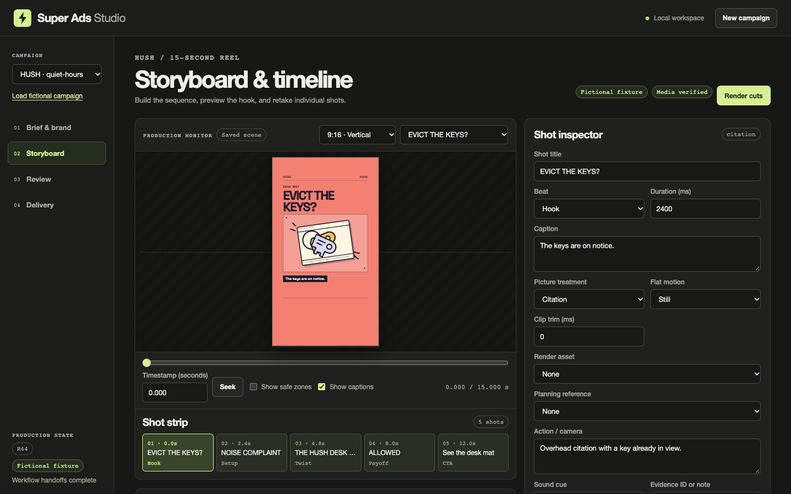

# Super Ads Studio

A local-first workspace for turning ad briefs into storyboards, reviewed cuts, and ready-to-share video files.



*The Quiet Hours storyboard in Super Ads Studio. Quiet Hours is a fictional campaign included with the project.*

## What you can do

- **Plan** a campaign with a brief, concept board, and six production workflows.
- **Edit** a shot timeline, compare opening hooks, and import images, clips, and audio.
- **Review** cuts with safe-zone overlays, captions, and timecoded feedback.
- **Deliver** vertical, square, and landscape MP4s with captions, reports, and approval checks.

The browser and CLI share the same local workspace. The demo runs without an API key.

## Quickstart

You’ll need Python 3.11+, Node 22+, and FFmpeg 7+ with `ffprobe` on macOS or Linux.

From the repository root:

```bash
python3 -m venv .venv
source .venv/bin/activate
python3 -m pip install -r requirements-dev.txt
npm ci
npx --no-install playwright install chromium
python3 -m studio demo
python3 -m studio serve
```

Open [Studio on your computer](http://127.0.0.1:8765)
and select **Quiet Hours**. Start in Storyboard to explore the
five-shot timeline and two opening hooks, or choose **New campaign**
to start with your own brief.

Projects and imported media are stored under `.studio/`.

<details>
<summary>CLI rendering and verification</summary>

Preview a hook, render the cuts, and generate the demo report:

```bash
python3 -m studio hook quiet-hours eviction
python3 -m studio render quiet-hours
python3 -m studio report quiet-hours
python3 -m studio materialize quiet-hours
```

The files are saved in `outputs/quiet-hours/`.
Choose a new destination with `materialize --output` for repeat exports.
See the [demo guide](examples/quiet-hours/README.md)
for reproduction steps and measured render results.

Run the local checks:

```bash
python3 scripts/verify_studio.py --doctor
python3 scripts/verify_studio.py
```

On Debian or Ubuntu, install Chromium system dependencies with
`npx --no-install playwright install --with-deps chromium`.

</details>

## Documentation

| Guide | What it covers |
| --- | --- |
| [Campaign workflows](workflows/) | Reel, TVC, Diwali, launch, UGC, and big-event formats |
| [Production guide](docs/STORYFORGE_PRODUCTION.md) | Storyboards, continuity, shot retakes, clips, and audio |
| [Studio architecture](docs/HARNESS.md) | Local storage, agent handoffs, and release approvals |
| [Release evidence](docs/PROGRESS.md) | Test results, rendering checks, and delivery evidence |

For agent workflows, start with [AGENTS.md](AGENTS.md) or [CLAUDE.md](CLAUDE.md).

[MIT license](LICENSE)
